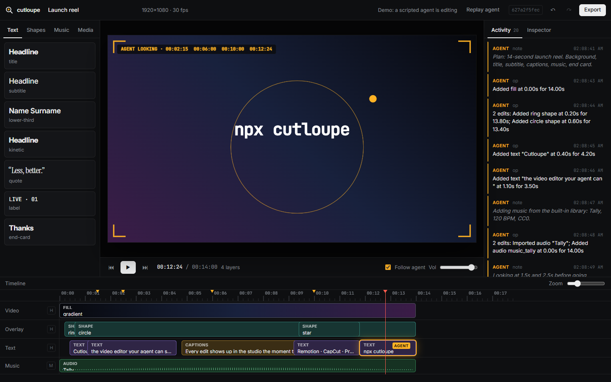

<p align="center"></p>

<h1 align="center">Cutloupe</h1>
<p align="center">A video editor your agent can see.</p>

<p align="center">
  <a href="https://cutloupe.vercel.app">Website</a> (<a href="https://bryankwandou.github.io/cutloupe/">mirror</a>) ·
  <a href="https://cutloupe.vercel.app/studio/">Studio demo</a> ·
  <a href="docs/DEVNET.md">Devnet proof</a> ·
  <a href="docs/DESIGN.md">Design notes</a>
</p>

Cutloupe is an MCP server with a live studio. Your agent (Claude Code, Antigravity, Codex, or any MCP client) edits a real timeline: cuts, titles, shapes, keyframes, captions, music. You watch each edit land in the studio and can edit alongside it. Before the agent calls the job done, the `look` tool renders the actual frames and returns them as an image, so the agent checks its own work instead of guessing.

When you are finished, export an MP4, or carry the timeline into DaVinci Resolve, Premiere Pro, CapCut or Remotion.



## Why it exists

Agents can already write ffmpeg commands and Remotion code. What they cannot do is see the result. They hand back a file and hope the title is not sitting on the subtitle. Cutloupe gives the agent eyes on the same compositor that produces the export, and gives the person a live view of what the agent is doing so they can step in early.

## What is in the box

| Part | What it does |
| --- | --- |
| `packages/core` | The timeline model, a pure `applyOp` reducer, the compositor (`renderFrame`), exporters, caption timing, the music synthesizer. No Node or DOM dependencies. |
| `packages/studio` | The browser studio: preview, timeline with drag and trim, inspector, library, activity feed. Also runs headless in `?render=1` mode for `look` and MP4 export. |
| `packages/mcp` | The MCP server (stdio) plus a local HTTP and WebSocket server that keeps every open studio in sync. 28 tools. |
| `programs/cutloupe-ledger` | Anchor program on Solana devnet: commit the timeline hash, seal an exported file against it. Optional. |
| `apps/site` | The landing page, in English, Indonesian, Spanish and Japanese. |

## Install

Requirements: Node 20 or newer, `ffmpeg` and `ffprobe` on your PATH, Chrome or Edge installed (used headless for rendering).

```bash
git clone https://github.com/bryankwandou/cutloupe
cd cutloupe
npm install
npm run build
```

Register the server with your agent.

**Claude Code** (run inside the cutloupe folder):

```bash
claude mcp add cutloupe -- node "$PWD/packages/mcp/bin/cutloupe.mjs"
```

**Antigravity**: Agent panel → MCP servers → Manage → View raw config, then add:

```json
{
  "mcpServers": {
    "cutloupe": { "command": "node", "args": ["C:/path/to/cutloupe/packages/mcp/bin/cutloupe.mjs"] }
  }
}
```

**Codex CLI** (`~/.codex/config.toml`):

```toml
[mcp_servers.cutloupe]
command = "node"
args = ["C:/path/to/cutloupe/packages/mcp/bin/cutloupe.mjs"]
```

Then ask for something like: *"Make a 20-second vertical teaser from intro.mp4 with bold captions and calm music, and check it before you export."* The studio opens at `http://127.0.0.1:4321` on the first edit.

To open only the studio, without an agent: `node packages/mcp/bin/cutloupe.mjs studio`.

The npm package is not published yet; install from GitHub for now.

### Environment

| Variable | Meaning |
| --- | --- |
| `CUTLOUPE_PORT` | Studio port. Default 4321; the next free port is used if it is taken. |
| `CUTLOUPE_HOME` | Projects, music and exports. Default `~/.cutloupe`. |
| `CUTLOUPE_NO_OPEN` | `1` stops the studio opening in the browser. |
| `CUTLOUPE_CHROME` | Chrome or Edge executable, if not in the usual place. |
| `CUTLOUPE_KEYPAIR` | A Solana devnet keypair file. Turns on the `ledger` tool. |
| `CUTLOUPE_PROGRAM_ID`, `CUTLOUPE_RPC` | Override the ledger program and RPC endpoint. |
| `CUTLOUPE_WHISPER_MODEL` | Whisper model name, or a ggml file for whisper.cpp. |

## Tools

| Group | Tools |
| --- | --- |
| Project | `open_studio` `new_project` `get_project` `open_project` `list_projects` `set_project` |
| Media | `import_media` `add_media_clip` `extract_audio` |
| Graphics and motion | `add_text` `add_shape` `add_background` `keyframe` `set_transition` |
| Edit | `edit_clip` `move_clip` `split_clip` `remove_clip` `apply_ops` `history` `add_marker` |
| Sound and captions | `add_captions` `extract_captions` `list_music` `add_music` |
| See and ship | `look` `export` `ledger` |

Every edit, from the agent or from a person in the studio, goes through the same `applyOp` reducer and the same undo history. `apply_ops` applies a batch all at once or not at all.

## Exports

| Format | Opens in | Left behind (listed in NOTES.txt) |
| --- | --- | --- |
| `mp4` | anywhere | nothing: it is the render |
| `fcpxml` (1.10) | DaVinci Resolve, Final Cut Pro | text animation, grades, shapes and fills |
| `xmeml` (FCP7 XML) | Adobe Premiere Pro | titles, shapes and fills; captions travel as `.srt` |
| `capcut` | CapCut desktop, experimental | shapes, fills, keyframes; newer builds encrypt drafts and may refuse it |
| `remotion` | Remotion project (`timeline.json` + `Reel.tsx`) | Remotion's license terms apply to larger companies |
| `otio` | OpenTimelineIO adapters | overlapping clips on one track |
| `srt`, `vtt`, `project` | players, editors, Cutloupe | caption styling |

## Captions and music

`extract_captions` reads `.srt`/`.vtt` files, or the first subtitle stream in a video. If neither exists and Whisper (`openai-whisper` or `whisper.cpp`) is installed, it transcribes locally. Words get their own timings in every case.

The music library is six original tracks synthesized from code (`packages/core/src/music.ts`), released under CC0.

## Edit ledger (Solana devnet)

Optional. With `CUTLOUPE_KEYPAIR` set, the `ledger` tool:

1. `open_reel`: creates a Reel account for the project (PDA `["reel", authority, reel_id]`).
2. `commit_cut`: moves the reel head from the previous timeline hash to the new one. A stale `prev` is rejected (`StaleHead`).
3. `seal_export`: writes a Seal account (PDA `["seal", file_sha256]`) for an exported file, only against the current head (`NotHead` otherwise). The seal records who edited (agent, person, both) and whether media or voice are synthetic.

Anyone can verify a file by hashing it; the website does this in the browser. Program ID `G6kWfHR1X2tHFgwHvrc5soiXwUF4bYXprv7YMTJnx5eY`. Transactions and checks are in [docs/DEVNET.md](docs/DEVNET.md).

## Development

```bash
npm run build        # studio, server, site, core
npm test             # core unit tests (node --test)
npm run typecheck    # tsc --noEmit over every package
npm run smoke        # drives the real MCP server over stdio through every tool and export
npm run site         # serve site/ at http://127.0.0.1:4400
npm run walkthrough  # re-record the walkthrough video from the site and studio
CUTLOUPE_KEYPAIR=... npm run ledger:check   # devnet success and failure paths
```

## Limits

- It does not generate footage. It edits and animates what you give it.
- Speech-to-text needs Whisper installed locally.
- The FCPXML, Premiere and CapCut exports pass structural tests, but have not yet been opened in Resolve, Premiere or CapCut on this release.
- MP4 export renders each frame in headless Chrome. An 8-second 1080p reel took 97 to 150 seconds on the test machine.

## License

MIT. The music library is CC0.
